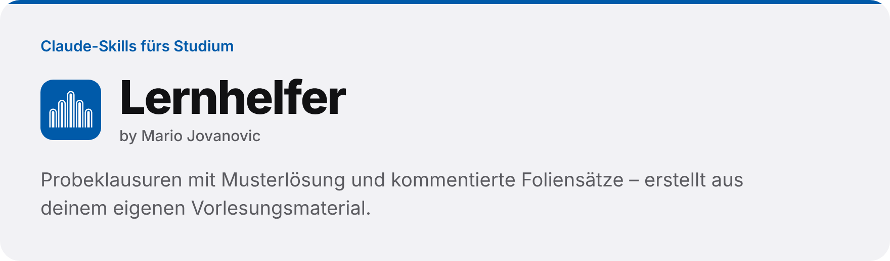
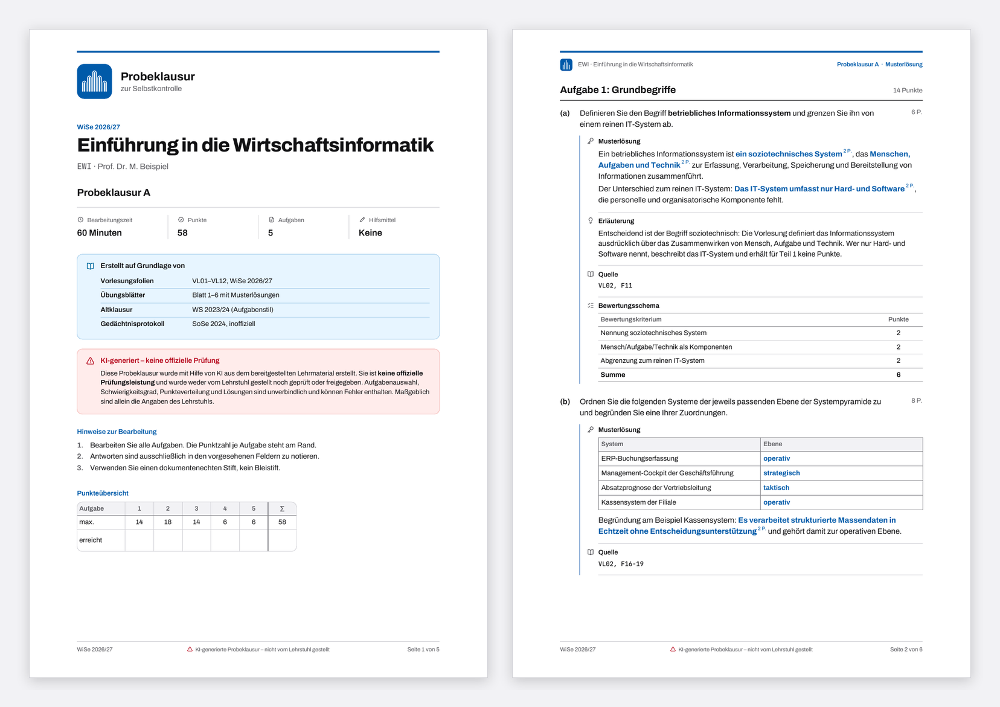
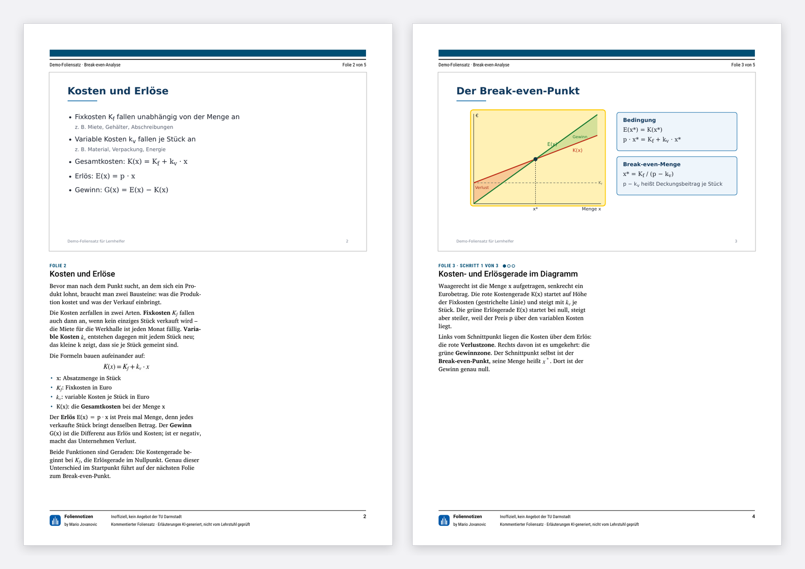
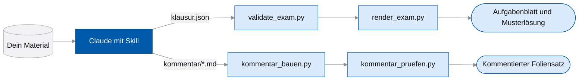

<picture>
  <source media="(prefers-color-scheme: dark)" srcset=".github/assets/banner-dark.png">
  
</picture>

<p>
  
  
  <a href="https://github.com/MarioJovc/lernhelfer/actions/workflows/pruefen.yml"></a>
  
</p>

Zwei Skills für Claude, die aus deinem Vorlesungsmaterial Lernmaterial machen. Der **Klausurtrainer** erstellt Probeklausuren mit Musterlösung und Bewertungsschema, die **Foliennotizen** erklären einen Foliensatz Folie für Folie, als wärst du in der Vorlesung gewesen. Entstanden im Wirtschaftsinformatik-Studium an der TU Darmstadt, nutzbar für jedes Fach. Die Skills sind auf Deutsch geschrieben; die Foliennotizen kommentieren in der Sprache, in der du schreibst.

**Projektseite:** [mariojovc.github.io/lernhelfer](https://mariojovc.github.io/lernhelfer/) · **Download:** [neueste Version](https://github.com/MarioJovc/lernhelfer/releases/latest)

## Funktionen

- **Probeklausur und Musterlösung** als zwei PDFs aus einer gemeinsamen Datei, mit Punkten, Bewertungsschema und Quellangabe je Aufgabe
- **Multiple Choice ohne Muster:** Die Positionen der richtigen Antworten werden vorher ausgelost, ein Skript prüft auf erratbare Hinweise
- **Altklausur als Vorlage:** Layout und Deckblatt einer echten Klausur nachbilden, ohne ihre Aufgaben oder Logos zu übernehmen
- **Kommentierter Foliensatz:** jede Folie unverändert oben, darunter die Erklärung, jede tragende Formel mit Legende
- **Schritt für Schritt:** Kernfolien bekommen eigene Seiten mit gelben Markierungen, am Ende steht eine Zusammenfassung
- **Geprüft statt geschätzt:** Skripte rechnen Punktsummen nach und vergleichen jede eingebettete Folie pixelgenau mit dem Original

## Beispiele



**Klausurtrainer** – Probeklausur zum erfundenen Modul „Einführung in die Wirtschaftsinformatik“: [Aufgabenblatt](beispiele/klausurtrainer/EWI_Probeklausur_A_Aufgabenblatt.pdf) · [Musterlösung](beispiele/klausurtrainer/EWI_Probeklausur_A_Loesungen.pdf) · [klausur.json](beispiele/klausurtrainer/klausur.json)



**Foliennotizen** – Demo-Foliensatz „Break-even-Analyse“: [Original](beispiele/foliennotizen/Break-even-Analyse.pdf) · [kommentierte Fassung](beispiele/foliennotizen/Break-even-Analyse_kommentiert.pdf) · [Kommentar als Markdown](beispiele/foliennotizen/kommentar/01.md)

## Installation

### In claude.ai und der Desktop-App

Voraussetzung: Unter **Settings → Capabilities** ist die Code-Ausführung eingeschaltet („Code execution and file creation“, in neueren Versionen „Create and edit files“).

1. Lade die ZIP-Datei des Skills herunter: [klausurtrainer.zip](https://github.com/MarioJovc/lernhelfer/releases/latest/download/klausurtrainer.zip) · [foliennotizen.zip](https://github.com/MarioJovc/lernhelfer/releases/latest/download/foliennotizen.zip)
2. Öffne [claude.ai/customize/skills](https://claude.ai/customize/skills), klicke auf **+**, dann auf **Create skill** und **Upload a skill**, und wähle die ZIP-Datei aus. Entpacken musst du sie nicht.
3. Schalte den Skill ein.

### In Claude Code

Als Plugin mit beiden Skills:

```text
/plugin marketplace add MarioJovc/lernhelfer
/plugin install lernhelfer@lernhelfer
```

Die Skills heißen danach `/lernhelfer:klausurtrainer` und `/lernhelfer:foliennotizen`; Claude nutzt sie auch von selbst, wenn deine Anfrage passt. Ohne Plugin kopierst du die Ordner aus `skills/` in deinen persönlichen Skill-Ordner:

```powershell
git clone https://github.com/MarioJovc/lernhelfer.git
New-Item -ItemType Directory -Force "$HOME\.claude\skills" | Out-Null
Copy-Item -Recurse lernhelfer\skills\* "$HOME\.claude\skills\"
```

```bash
git clone https://github.com/MarioJovc/lernhelfer.git
mkdir -p ~/.claude/skills && cp -r lernhelfer/skills/* ~/.claude/skills/
```

Die Skripte brauchen Python 3 und ein paar Pakete, für PowerPoint-Dateien außerdem LibreOffice:

```bash
pip install reportlab fonttools pdfplumber pypdfium2                 # Klausurtrainer
pip install pymupdf pyphen reportlab matplotlib numpy pillow python-pptx  # Foliennotizen
```

## Nutzung

### Klausurtrainer

Lade dein Material hoch: Vorlesungsfolien, Übungsblätter, Skript und, wenn vorhanden, eine Altklausur. In claude.ai lohnt sich ein Projekt je Modul – was in den Projektdateien liegt, kennt Claude in jedem Chat. Dann zum Beispiel:

> Erstelle eine Probeklausur für Datenbanksysteme: 90 Minuten, 90 Punkte, mit zwei Multiple-Choice-Aufgaben.

Claude fasst das Material zuerst in einem Destillat zusammen und zeigt dir ein Gerüst mit Themen, Aufgabentypen und Punkten. Erst nach deiner Freigabe entstehen die Aufgaben. Ein Skript prüft Punkte und Quellangaben, dann bekommst du Aufgabenblatt und Musterlösung als PDF. Für Änderungen genügt ein Satz wie „Aufgabe 3 ist zu leicht“ – geändert wird nur diese Aufgabe.

### Foliennotizen

Lade einen Foliensatz als PDF oder PowerPoint-Datei hoch und schreib zum Beispiel:

> Ich habe die Vorlesung verpasst. Kommentier mir bitte diesen Foliensatz.

Du bekommst ein PDF im Hochformat: oben jede Folie unverändert, darunter die Erklärung, wichtige Folien zusätzlich Schritt für Schritt, am Ende eine Zusammenfassung mit Takeaways und Kernbegriffen. Ein PDF-Export aus PowerPoint gibt die Schriften genauer wieder als die PowerPoint-Datei selbst. Wünsche wie „Folie 12 bitte ausführlicher“ ändern nur diese Folie.

## So funktioniert's



Claude schreibt nur den Inhalt, als JSON oder Markdown. Layout und Prüfungen erledigen Python-Skripte – deshalb sehen die PDFs immer gleich aus, und Fehler wie falsche Punktsummen oder fehlende Folien fallen auf, bevor du das Ergebnis bekommst.

## Gut zu wissen

- **Nur dein Material.** Der Klausurtrainer nimmt Inhalte ausschließlich aus dem, was du hochlädst, und belegt jede Aufgabe mit einer Fundstelle. Findet er keinen Beleg, meldet er eine Lücke, statt zu raten.
- **KI-Hinweis.** Probeklausuren und kommentierte Foliensätze sagen auf jeder Seite, dass der Inhalt KI-generiert ist und nicht vom Lehrstuhl stammt. Der Hinweis bleibt auch auf Wunsch stehen.
- **Keine Logos.** Logos, Siegel und Wappen von Lehrstühlen oder Hochschulen werden nie übernommen.
- **Urheberrecht.** Folien und Altklausuren gehören den Lehrenden. Nutze die Ergebnisse für dich und teile sie nur, wo das erlaubt ist.
- **KI kann sich irren.** Halte Musterlösungen und Erklärungen gegen dein Material, bevor du dich auf sie verlässt.

## Projektstruktur

```text
lernhelfer/
├── skills/
│   ├── klausurtrainer/   SKILL.md, Renderer und Prüfskripte, Schema, Schriften, Beispieldaten
│   └── foliennotizen/    SKILL.md, Analyse-, Build- und Prüfskripte, Leitfaden, Schriften
├── beispiele/            fertige Beispiel-PDFs mit ihren Quelldateien
├── docs/                 Projektseite (GitHub Pages)
├── .claude-plugin/       Marketplace-Datei für Claude Code
└── requirements.txt      Python-Pakete für die Skripte
```

## Entwicklung

| Aufgabe | Befehl |
|---|---|
| Pakete installieren | `pip install -r requirements.txt` |
| Beispielklausur prüfen | `python3 skills/klausurtrainer/scripts/validate_exam.py beispiele/klausurtrainer/klausur.json` |
| Beispielklausur rendern | `python3 skills/klausurtrainer/scripts/render_exam.py beispiele/klausurtrainer/klausur.json --out arbeit` |
| Plugin prüfen | `claude plugin validate .` |
| Neue Version veröffentlichen | `git tag v1.1.0 && git push origin v1.1.0` |

Bei jedem Push baut der Workflow „Prüfung“ beide Beispiele neu und prüft sie. Ein Tag `v…` erzeugt ein Release mit je einer ZIP-Datei pro Skill.

## Mitwirken

Fehler und Ideen gern als [Issue](https://github.com/MarioJovc/lernhelfer/issues/new/choose). Bitte lade dabei keine Vorlesungsfolien, Altklausuren oder persönlichen Daten hoch.

## Lizenz

Code und Skill-Texte stehen unter der [MIT-Lizenz](LICENSE). Die mitgelieferten Schriften behalten ihre eigenen Lizenzen: Archivo, JetBrains Mono und Charis SIL unter der SIL Open Font License 1.1, Roboto und Roboto Condensed unter der Apache-Lizenz 2.0. Die Lizenztexte liegen jeweils in `assets/fonts/` des Skills.

<br>

<p>
  
  <sub><b>Lernhelfer</b> · by Mario Jovanovic<br>Inoffiziell, kein Angebot der TU Darmstadt</sub>
</p>
